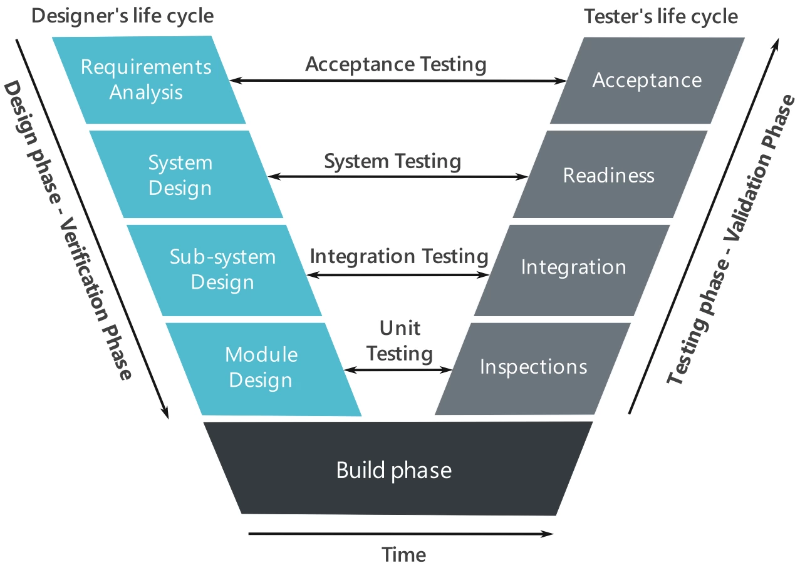

# ClawDrone

Development and programming of an autonomous **hexacopter based on a DJI F550 chassis**, equipped with a claw, capable of detecting tennis balls from the air, navigating toward them, picking them up, and transporting and dropping them into a designated basket.

> **Phase 1 — Requirement Analysis** (first step of the V-diagram). This document is the formal description and organisation of the project: the mission, the high-level requirements, and how the work is split into departments and interconnected. Design, implementation, integration, and verification are later phases. See the V-diagram in [`Pictures/v-diagram.png`](Pictures/v-diagram.png).

## 1. Mission & Concept of Operations

The system is an autonomous hexacopter (DJI F550 chassis) equipped with a claw that finds tennis balls on the ground, grasps them, and drops them into a designated basket. The drone carries **one ball per trip**, so the mission is a short cyclic task repeated until the battery requires landing.

High-level mission sequence:

1. **Take off** and reach a safe search altitude.
2. **Search** the area for tennis balls.
3. **Detect** a tennis ball and estimate its 3D position.
4. **Approach** the ball and **align** precisely above it.
5. **Grasp** the ball with the claw.
6. **Transport** the ball to the designated basket (known destination).
7. **Release** the ball into the basket.
8. **Repeat** from step 2 until the battery requires a landing; then **land** safely.

## 2. Objectives

- **Primary objective:** complete the autonomous cycle of detecting, grasping, transporting, and dropping tennis balls.
- **Secondary objective (stretch):** implement route optimization to collect the balls along the shortest possible path, completing the task faster. This is an optional enhancement, not part of the core requirements.
- **Success criteria (high level):** the mission sequence above can be performed autonomously, with the drone safely returning/landing. Quantitative targets are **TBD** (see [Open questions](#6-open-questions--tbd)).

## 3. High-level requirements

### Functional

- Detect tennis balls from the air.
- Estimate the 3D position of a detected ball.
- Navigate toward the ball and align precisely above it.
- Actuate the claw to grasp the ball.
- Hold the ball while flying.
- Transport the ball to the designated basket.
- Release the ball into the basket.

### Performance (all targets TBD)

- Payload and claw grasp capability: **TBD**
- Flight time per mission: **TBD**
- Ball detection rate and range: **TBD**
- Grasp success rate: **TBD**
- Mission cycle time (per ball): **TBD**
- Positioning/alignment accuracy: **TBD**

### Constraints & assumptions

- **Platform:** DJI F550 hexacopter chassis, modified to carry the claw and the onboard electronics.
- **PX4** is the autopilot and **Gazebo** is the integration testbed; both live in the **Control** department (see [§4](#4-system-organisation-into-departments)).
- Perception is **camera-based** (Vision department, which owns the camera selection).
- Target operation environment, lighting conditions, and applicable drone regulations: **TBD**.
- Assumed ball properties (size, colour) as per a standard tennis ball.

## 4. System organisation into departments

The project is split into **three departments**:

| Department | Scope | Main deliverables |
|---|---|---|
| **Control** | PX4 autopilot (firmware and parameters, EKF2 state estimation, flight modes, offboard/position control, failsafes, MAVLink comms) and the ROS 2 integration/comms-software stack. Owns **all simulation**: Gazebo world, drone + claw + camera models, sensor plugins, and the PX4 SITL / ROS 2 bridges. | First working simulation, autopilot configuration, simulated sensors and camera, and a **simple mission manager** (takeoff → search → align → grasp → drop state machine). |
| **Hardware** | Physical platform. **Claw design** (spoon/grabber-crane type gripper adapted to tennis balls): mechanism, materials, mounting, CoG/payload, retention and release. **Real sensors** (IMU, barometer, magnetometer, GNSS, optical flow, rangefinder/ToF): selection, mounting, calibration, PX4 driver configuration. **All electronics**: power architecture (battery → PDB → BEC), ESCs, servo driver, companion-computer hardware, wiring harness, connectors, current/grasp sensing. | CAD/model and mechanical interface, mass/CoG spec, power rails and wired harness, calibrated sensor suite, **isolated per-subsystem tests** and **hardware integration**. |
| **Vision** | Camera-based perception. **Camera component selection**, detection and 3D localization of tennis balls, alignment error, grasp-trigger logic, and coordinate transforms. | **Simple detection test with a real camera**, ball pose + confidence output, grasp trigger, and **integration of the vision pipeline in simulation**. |

> Ownership notes: **Hardware** owns the *physical* platform (claw, real sensors, electronics, integration); **Control** owns the *software/firmware* stack and its *simulated* counterpart (PX4 + Gazebo); **Vision** owns the *camera + perception* pipeline, from component selection through real-camera testing to sim integration.

### Department interconnections

The departments interconnect across three layers:

- **Physical / power** — Hardware is the hub: battery, power rails, harness, and connectors feed PX4, the claw servo, the companion computer, and the sensors.
- **Data / comms** — two buses matter:
  - **MAVLink / uXRCE-DDS (or MAVROS)** between **PX4 ↔ companion computer** (state, arming, offboard setpoints).
  - **ROS 2 topics/services** on the companion (Vision → target, Vision → grasp command, grasp feedback → mission logic).
- **Simulation** — Gazebo, owned by Control, is a cross-cutting testbed rather than a silo: everything is validated in simulation first (*simulation-first*).

### Interface register

| ID | From → To | What | How |
|---|---|---|---|
| I1 | Hardware → Control/PX4 | IMU/baro/mag/GNSS/flow/range data (real) | I2C/SPI/UART/CAN → PX4 drivers → EKF2 |
| I2 | Camera → Vision | Video frames (real or sim) | CSI/USB (sim: ROS 2 image topic) |
| I3 | Vision → Control/PX4 | Ball pose + confidence, alignment error | ROS 2 topic → offboard setpoint (uXRCE-DDS/MAVROS) |
| I4 | Control/PX4 → Vision | Vehicle state, arming/failsafe | MAVLink / ROS 2 |
| I5 | Control/PX4 → Hardware | Motor + claw servo commands | PWM/DShot/CAN |
| I6 | Hardware → Claw | Servo power + signal | Harness/connector |
| I7 | Claw → Vision | Grasp confirmation | Limit switch / current sense → ROS 2 |
| I8 | Hardware → all | Regulated power rails | Battery → PDB → BEC |
| I9 | Hardware (mech) → Hardware (elec.) | Actuator/connector spec | Interface drawing |
| I10 | Hardware (mech) → Control (Gazebo) | CAD, mass, claw joint model | SDF/URDF |
| I11 | Control (Gazebo) → Control/PX4 | Simulated sensors/actuators | PX4 SITL + gz bridge |
| I12 | Control (Gazebo) → Vision | Simulated camera | ROS 2 bridge |
| I13 | Vision → Hardware | Grasp trigger | ROS 2 → servo driver |

### Standards to fix early

- **Coordinate frames**: PX4 uses NED/FRD while ROS 2 uses ENU/FLU. Agree on the transform chain camera → body → NED and on who publishes it (Vision).
- **Timestamps / sync**: agree message timestamps so detection and vehicle state align for a moving target.

### Integration testbed

Gazebo is the **official integration testbed** (owned by Control): every interface above (I1–I13) must pass in simulation before being connected on hardware.

## 5. Phase scope, deliverable & V-diagram

This phase is the **requirements analysis** step of the V-diagram. Its deliverable is this formal description of the project and its organisation into departments.

## 6. Open questions / TBD

- **Claw command path**: PX4 AUX PWM channel vs. companion/ROS 2 → servo driver. Not yet decided.
- **Quantitative targets**: payload, flight time, detection rate, grasp success rate, cycle time, alignment accuracy.
- **Environment and regulations**: operating environment, lighting, and applicable drone rules.
